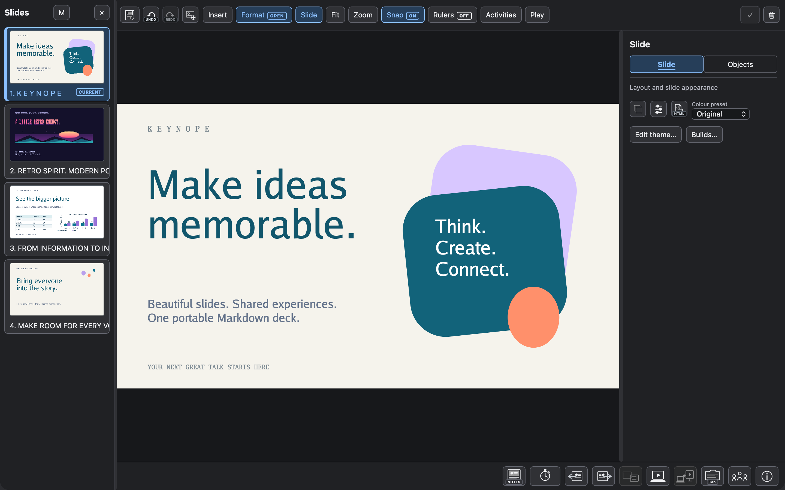
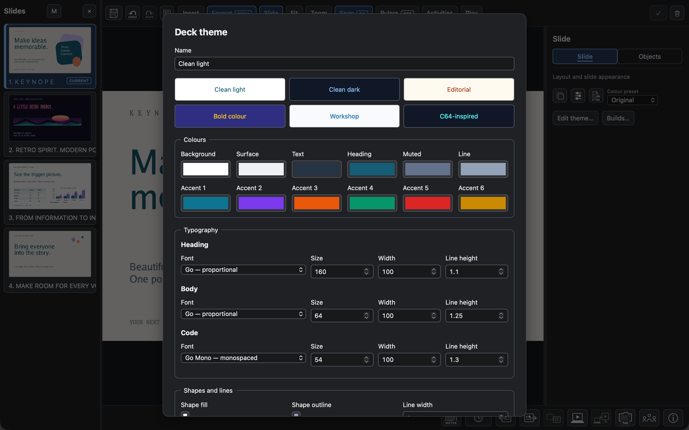
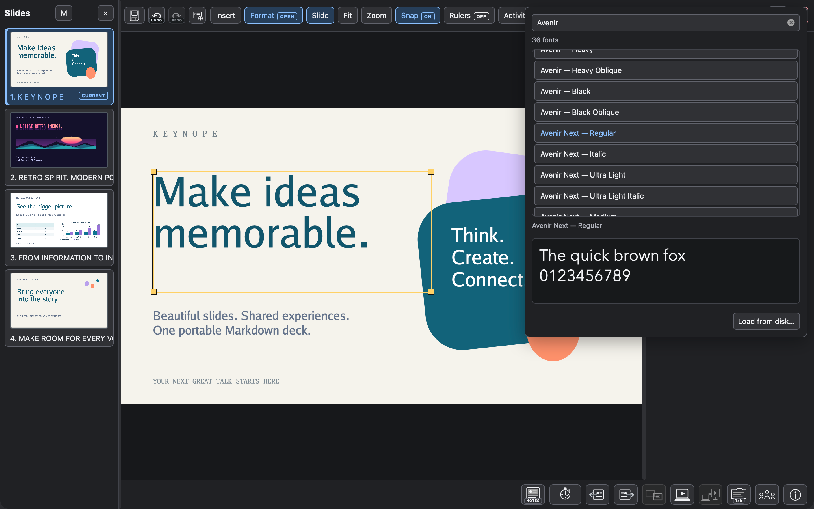
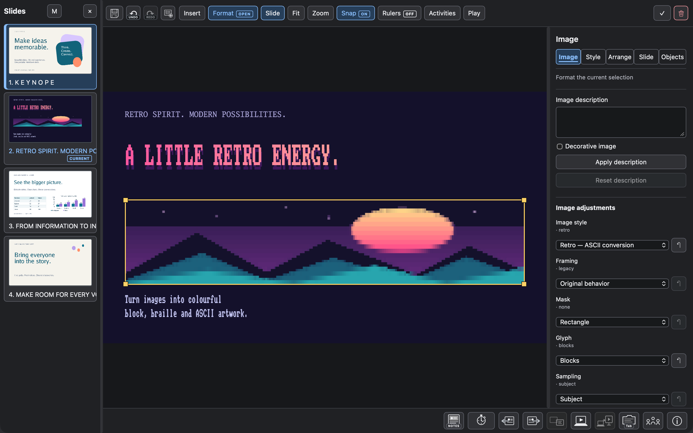
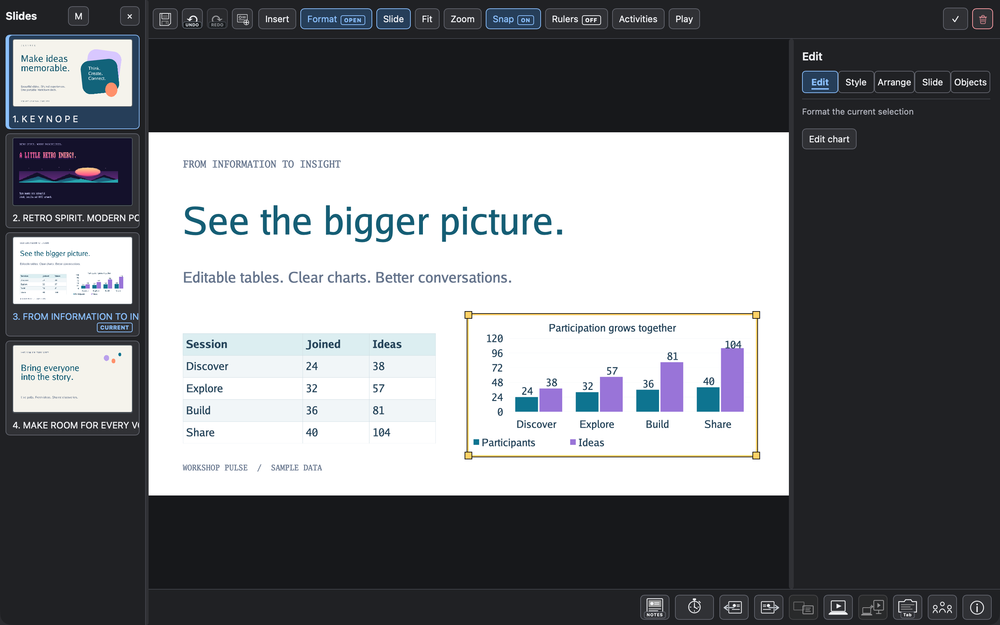
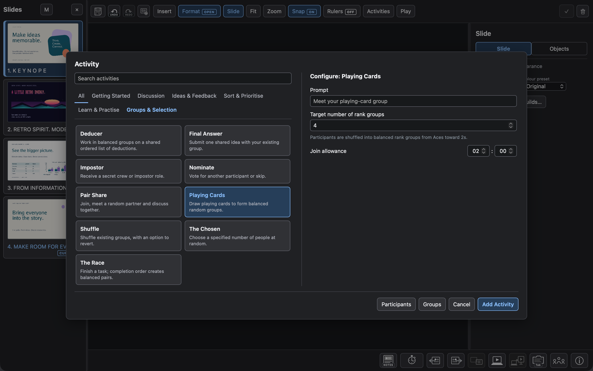

# Keynope

Keynope is a presentation and workshop editor for macOS and the web, combining C64 personality with modern typography, vector shapes and interactive activities. Create slides visually and keep your presentation in a portable Markdown file.



## Get Keynope

Download Keynope from the Apple [App Store](https://apps.apple.com/us/app/keynope/id6793679625). Don't forget to give it a kick ass review.

Or install the Mac app with Homebrew:

```sh
brew tap keynope/keynope
brew install --cask keynope
```

## Make it yours

Start with a template or a blank presentation. Use master slides and layouts to reuse designs, and deck themes to coordinate colours and fonts. Individual elements can follow the theme or keep their own styling.

Choose widescreen, standard, portrait, ultrawide or a custom page size. Your slides, layouts and styling travel with the Markdown deck; imported images and GIFs can be embedded too.



### Text

Choose the bundled Keynope C64, Go or Go Mono font, browse installed fonts on your Mac, or load a TTF/OTF file from disk. Fonts are embedded when their permissions allow it. Restricted fonts are saved as installed-font references, with a warning on save or export and a default-font fallback on other devices. Text using an embedded Preview & Print font is read-only; other content stays editable, and you can choose another font to unlock that text. Add headings, body text, bullet lists and code blocks, with independent font size and width controls.

Dragging a text box changes its available space and wrapping, not its font size. Align or justify text inside the box, and apply colour, gradients, outlines, shadows, rotation and opacity.



### Images, emoji and effects

Add images and animated GIFs, crop or mask them, adjust their colours, or turn them into colourful Retro artwork. Promote an image to a slide background while retaining its adjustments, and return it to an editable image when needed.

Colour emoji use the same bundled artwork across Mac, web and HTML presentations. Tint them with a single-colour scale while preserving shading, or keep their original colours. Add image descriptions or mark decorative images in the Style inspector.

Choose animated backgrounds and effects that adapt to your slide palette.

Add glow, blur, duotone/tritone colour treatments and posterisation, with radial,
reflected, diamond and angular gradients. Place shape outlines inside, centred
or outside the edge.



### Video

Use **Insert → Video** to embed an MP4, M4V or MOV clip directly in
the deck, within its remaining embedded-media capacity. Move, resize and rotate
it like other objects. Preview playback directly on the editor canvas, or use
the Video inspector to configure autoplay, looping and sound. When presenting
to an external display, control playback from your Mac without moving to the
second screen.

Standalone HTML exports include playable video; PDF and PowerPoint use a still
poster. Videos are not sent to workshop participants.

### Shapes and diagrams

Choose from an adjustable shape library, with independent fills, borders and text styling. Double-click a shape to add a label; the shape grows to accommodate its text.

Connect shapes with straight or elbow lines, customise their colour and arrowheads, and edit bends directly. Connections stay attached when shapes move or resize; Auto-route helps find a path around other shapes.

### Tables and charts

Create editable tables with merged cells, adjustable rows and columns, styled text, fills and borders.

Choose column, bar, line, area, pie or doughnut charts, including stacked columns and bars. Edit values directly or paste tab-separated data, then customise axes, legends, labels and colours.



### Arrange and reuse

Shift-drag to select multiple objects, then group them to move them together. Double-click a group to edit an individual member. Use alignment and spacing guides, drag rows in the Objects inspector to change layering, and name objects to keep complex slides organised.

Copy and paste objects between decks, or use Copy/Paste Style and format painting to reuse their appearance.

Use **⌘A** (Windows/Linux: **Ctrl+A**) to select the current slide's objects. While
editing text, the shortcut selects text as usual. Duplicate a slide from the
**Slide** inspector or with **⌘Shift+D / Ctrl+Shift+D**. **⌘D / Ctrl+D** also
duplicates the slide when no object is selected or the slide navigator has focus.

Open **Help → Keyboard Shortcuts** (**⌘/ / Ctrl+/**) for the complete reference.
The native **Slide**, **Arrange**, **Format** and **Play** menus expose the same
commands: create and reorder slides, change object layers and locking, format
text, start presenting and toggle speaker notes. Commands respect the current
selection and leave text fields, dialogs and active drags in control of input.

Turn on **Rulers** in the workspace toolbar (or **More actions**) to measure in
slide coordinates. The top and left rulers follow zoom and pan and show the
pointer position, measured from the slide's top-left corner.
Drag down from the top ruler or right from the left ruler to place an alignment
guide across the slide. Drag a guide to move it; click it or drag it outside the
slide to remove it. Click either ruler to clear all guides. Focused guides also support arrow keys (Shift for
larger steps) and Delete. Guides are workspace aids and are not saved or exported.

With no object selected, Left/Up and Right/Down navigate between slides. Click
blank canvas to clear the selection and return to the **Slide** inspector.
Right-click a slide thumbnail for slide commands and layouts, or an object for
editing, clipboard, grouping and arrangement commands. Detailed formatting stays
in the inspector. **Shift+F10** opens the same action menu from the keyboard.

## Present

Present on your Mac or a connected external display while retaining your editing controls. Keep speaker notes beneath each slide, use the built-in timer, and guide attention with a laser pointer, spotlight or temporary ink.

Reveal objects in an ordered build sequence and add slide transitions. Preview the sequence before presenting.


## Run interactive workshops

Attach an activity to a slide using the permanent Activities button. Participants join from their own device using a link, access code or QR code. An Onboarding activity gives the workshop a persistent session link, lobby, chat and access to subsequent activities.

Activities include:

- **Pulse** for confidence checks and polls.
- **Storm** for collecting ideas.
- **Sort** for placing ideas into named destinations.
- **Dot Voting** for prioritising ideas, including contributions from a previous activity.
- **Deducer** for shared, ordered group lists, and **Final Answer** for one submission per existing group.
- Drawing, introductions, questions, grouping games and other workshop exercises.



Open an activity's controls and press **Start** to begin. **Close** dismisses the controls without stopping a running activity; its status remains in the bottom bar. **Stop/Done** ends it, **Reopen** continues it, and **Reset** clears its result. Anonymity and reveal options depend on the activity.

Turn reference slides into participant tabs with **Tab** in the bottom toolbar. They stay available in the lobby without appearing in the main presentation sequence.

Completed activity results can be saved in the deck. **Saved decks may contain participant names and responses.** Audience slide views and static exports exclude private result archives and speaker notes, but review any participant information you deliberately place on a slide before sharing.

## Save and share

Keep the Markdown deck as your editable source, then choose the format that fits your audience:

- **HTML:** a standalone presentation with animations and interactive playback.
- **PDF:** selectable text and vector artwork where supported, or exact-appearance image pages.
- **PowerPoint:** editable text, tables, charts, shapes and supported connectors, with embedded media and fonts.

PowerPoint import and export do not require PowerPoint to be installed. Some effects, animation and formatting differ between formats; review the conversion notes and check the result in your intended viewer. Retro image artwork exports as pictures, while ordinary C64 text remains editable text.

For supported conversions and format limits, see [Format and export details](docs/formats.md).

## Build with an AI assistant

Keynope includes an opt-in MCP server for editing the presentation currently
open in the Mac app. Enable **Automation (MCP)** and connect your AI client.
Human and MCP edits share the same in-memory document, rendering and Undo
history. Changes reach disk through the usual **Save** workflow; MCP's
`deck_save` invokes that workflow too, including the Save dialog for untitled decks.

MCP has its own slide and object selection. Its edits do not switch your slide
or scroll your navigator. If MCP changes an object you are editing, that object's
pending draft or drag is cancelled and it is deselected. Unrelated edits remain
active. Each MCP write identifies the document and a known revision; concurrent
changes are returned as deltas, and `deck_changes` can retrieve changes between
operations. File/Open and File/New remain controlled by the user. The MCP URL
stays the same when switching documents; clients must inspect the new document
before editing it.

The standalone `--mcp --workspace` CLI still supports isolated authoring without
an editor window. Live app MCP uses a temporary asset/export workspace and does
not automatically grant access to the open document's folder.

## Build from source

On macOS 14 or later, install Go and the Xcode Command Line Tools, then run:

```sh
make build
open bin/Keynope.app
```

Use File → Open to select a deck, or File → New to start a presentation. To install your local build in `/Applications`, run `make install`; for a user-only install, use `make install APPDIR="$HOME/Applications"`.

Build, test and repository details are in the [developer guide](docs/development.md).

## Community

Have an idea, suggestion, feedback, or a memorable Keynope anecdote? [Join the conversation in Keynope Discussions](https://github.com/keynope/keynope/discussions). Early experiments, presentation stories, feature concepts, and constructive criticism are all welcome.

Want to contribute code or report a bug? Read the [contribution guide](CONTRIBUTION.md).
